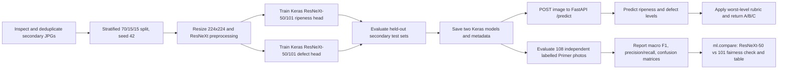

# ResNeXt-50 dan ResNeXt-101: data, training, evaluation, comparison, and API

## Dataset inventory

The supplied dataset was inspected in `D:\D4 Polije\Semester 5\Project\Data\Datasets`.
It is not copied into this repository.

| Dataset folder | Class | Files | Use |
|---|---|---:|---|
| `Sekunder/kematangan/Klasifikasi Kematangan Tomat/Tomat Matang` | Matang | 162 JPG | Ripeness model |
| `Sekunder/kematangan/Klasifikasi Kematangan Tomat/Tomat Setengah Matang` | Setengah matang | 169 JPG | Ripeness model |
| `Sekunder/kematangan/Klasifikasi Kematangan Tomat/Tomat Mentah` | Mentah | 173 JPG | Ripeness model |
| `Sekunder/cacat/Two Classes/Healthy` | Healthy | 1,600 JPG | Defect model (level 1) |
| `Sekunder/cacat/Two Classes/Reject` | Reject | 800 JPG | Defect model (level 3) |
| `Sekunder/cacat/Three Classes/Reject` | Reject | 800 JPG | Excluded: label meaning is not a separate defect level |
| `Sekunder/cacat/Three Classes/Ripe` | Ripe | 800 JPG | Excluded: mixes ripeness with the defect dataset |
| `Sekunder/cacat/Three Classes/Unripe` | Unripe | 800 JPG | Excluded: mixes ripeness with the defect dataset |
| `Primer/Foto` | 108 tomato photos | 108 HEIC | Independent final evaluation only |

The label workbook contains 108 labelled tomatoes. `id_tomat` is mapped to the
photo filename by `Primer/Label/mapping_nama_file.csv`. Its recorded grade
distribution is A: 17, B: 40, C: 51; the defect-level-3 subset contains 9
photos. The secondary JPGs inspected are 640x480 or 3024x4032; the HEIC photos
need HEIC-capable decoding. In total the supplied directories contain 5,304
JPG and 108 HEIC files; no corrupt JPG was found in the inspection.

Exact byte-for-byte duplicates were found across secondary folders. In the
Two Classes defect source, deduplication leaves 1,556 unique images (890
healthy, 666 reject); three content groups spanning eight files have
conflicting labels. Training deduplicates each task before splitting and
excludes those conflicting groups with a warning that names the files. The
ripeness source has 504 unique images. A reproducible image split is used
because the supplied secondary data has no tomato/group IDs; it cannot
guarantee separation by physical tomato if separate photos of one tomato
exist. The Primer set remains untouched by training.

The `Three Classes` folder is deliberately not used: its `Ripe` and `Unripe`
labels describe ripeness, while `Reject` does not provide the two other defect
severity labels required by the rubric. The two-class defect model distinguishes
healthy (level 1) from reject (level 3); it cannot learn defect level 2 from the
available secondary labels. The primary test reports binary defect metrics
only for level 1 and level 3 labels, but still evaluates the final A/B/C grade
for all labelled primary photos.

## Model and implementation

Two Keras transfer-learning models per architecture are trained using an
ImageNet-pretrained ResNeXt backbone (`image-classifiers`, Keras/TensorFlow-Keras
backend). Supported architectures: `resnext50` and `resnext101`. Both use the
same code path, split, hyperparameters, preprocessing, and metrics
(`ml/metrics.py`), so the only difference is backbone depth:

1. Ripeness: matang, setengah matang, mentah (levels 1, 2, 3).
2. Visible defect: healthy, reject (levels 1, 3).

ResNeXt-101 is the selected model because transfer learning makes use of
ImageNet visual features despite the modest labelled tomato datasets, while
its grouped residual blocks provide the specified ResNeXt architecture.
Separate heads keep ripeness and defect labels distinct and make the rubric
combination explicit. ResNeXt-101 is larger and slower than ResNeXt-50, so the
choice is not presented as an accuracy win until measured on identical splits.

The final grade uses the project rubric: the worse of the two predicted levels
determines A/B/C. Input images are resized to 224x224. Training uses a frozen
backbone followed by fine-tuning of its last layers, data augmentation,
validation-based early stopping, and the ImageNet ResNeXt preprocessing.
The Keras implementation and ImageNet weights are provided by
[`image-classifiers`](https://github.com/qubvel/classification_models), which
includes ResNeXt-101 for the TensorFlow-Keras backend.

Frameworks and tools: TensorFlow/Keras, `image-classifiers`, Pillow and
`pillow-heif`, scikit-learn, FastAPI, and Uvicorn. The model weights are
downloaded from ImageNet during training; a network connection is required.
`requirements-ml.txt` targets Python 3.11 for the TensorFlow 2.15/Keras 2.15
training environment.

## Train and evaluate

Install the requirements in Google Colab (or another Python 3.11 runtime):

```python
%pip install -r requirements-ml.txt
```

Mount the dataset, then train one or both architectures. Both in one run
(sequential, same seed and split):

```python
!python -m ml.train \
  --data-root "/content/drive/MyDrive/Datasets" \
  --models-dir "/content/drive/MyDrive/tomato-models" \
  --architecture resnext50 resnext101 \
  --seed 42
```

Only one architecture (for example the missing ResNeXt-50): `--architecture resnext50`.
Writing `--models-dir` to Google Drive keeps the models if the Colab runtime resets.
The data-root directory must contain `Primer` and `Sekunder`. For each
architecture `<arch>` (`resnext50` or `resnext101`) training writes:

- `models/ripeness_<arch>.keras` and `models/defect_<arch>.keras`
- One JSON metadata file per model (split manifest, hyperparameters, parameter count, training time)
- `models/evaluation_<arch>.json` (secondary + primary metrics, parameter count, latency, device)

Each model metadata file also stores the SHA-256-based train, validation, and
test split manifest so the ResNeXt-50 comparison can reuse the same image
partitions.

The JSON report contains the held-out secondary test metrics and the independent
Primer results. The primary evaluation can be repeated after training:

```python
!python -m ml.evaluate \
  --data-root "/content/drive/MyDrive/Datasets" \
  --models-dir models \
  --architecture resnext101
```

`ml.evaluate` updates the primary and efficiency sections of
`evaluation_<arch>.json` and keeps the stored secondary results. Use
`--no-write` to only print.

If a previous run completed a model's training but stopped while loading its
checkpoint, rerun with `--reuse-existing-models`. It skips training for
existing `.keras` files and evaluates those checkpoints before continuing with
missing model files. Use this only when the existing checkpoint is from the
same dataset, model configuration, and split seed. The option assumes any
existing checkpoint for that task is complete.

Evaluation metrics are accuracy, macro F1, per-class precision and recall,
confusion matrices, and classification reports, computed by the same functions
for every architecture. Review class-C recall and mistakes from C to A in
particular.

## Compare ResNeXt-50 and ResNeXt-101

After both architectures have reports in the same models directory:

```python
!python -m ml.compare --models-dir models --output models/compare_resnext.md
```

The command prints a table (secondary and primary macro F1, grade accuracy,
class-C recall, C-to-A errors, median/p95 latency, parameter count, device) and
verifies the comparison is fair: identical SHA-256 split manifests, identical
hyperparameters, the same primary evaluation set, and latency measured on the
same device. Any mismatch is printed as `PERINGATAN` and the status becomes
`TIDAK SETARA`; do not use such a table in the report.

Latency is measured with a fixed synthetic image, 3 warm-up runs and 30 timed
runs of both heads in sequence. Measure both architectures in the same Colab
runtime type. If one model was trained on a different runtime, re-run
`python -m ml.evaluate --architecture <arch>` for it in the current runtime
before comparing. This repository does not claim comparison results until both
models have actually been trained and evaluated.

## HTTP API

After training, start the API from the repository root:

```powershell
python -m uvicorn ml.api:app --host 0.0.0.0 --port 8000
```

`GET /health` reports whether model artifacts are present for each architecture.
Send a JPG, PNG, or HEIC as multipart form field `file` to `POST /predict`
(maximum 10 MiB). The optional query parameter `architecture` (`resnext50` or
`resnext101`) selects the model; without it the API uses the `TOMATO_ARCHITECTURE`
environment variable, default `resnext101`:

```powershell
curl.exe -X POST "http://127.0.0.1:8000/predict?architecture=resnext50" -F "file=@tomat.jpg"
```

Example response:

```json
{
  "model": "ResNeXt101",
  "architecture": "resnext101",
  "input_size": [224, 224],
  "ripeness": {
    "class": "matang",
    "level": 1,
    "confidence": 0.91,
    "probabilities": {
      "matang": 0.91,
      "setengah_matang": 0.06,
      "mentah": 0.03
    }
  },
  "defect": {
    "class": "healthy",
    "level": 1,
    "confidence": 0.87,
    "probabilities": {
      "healthy": 0.87,
      "reject": 0.13
    }
  },
  "grade": "A"
}
```

`TOMATO_MODELS_DIR` can point the API to a different directory containing both
`.keras` models and their JSON metadata. Interactive API documentation is at
`/docs`.

The ResNeXt backbone contains Lambda layers from the trusted
`image-classifiers` implementation. Checkpoints generated by this training
workflow are loaded with Keras `safe_mode=False`; only load model artifacts
created by this project, not files from untrusted sources.

## End-to-end flow


