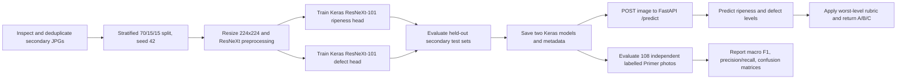

# ResNeXt-101: data, training, evaluation, and API

## Dataset inventory

The supplied dataset was inspected in `D:\D4 Polije\Semester 5\Project\Data\Datasets`.
It is not copied into this repository.

| Dataset folder | Class | Files | Use |
|---|---|---:|---|
| `Sekunder/kematangan/Klasifikasi Kematangan Tomat/Tomat Matang` | Matang | 162 JPG | Ripeness model |
| `Sekunder/kematangan/Klasifikasi Kematangan Tomat/Tomat Setengah Matang` | Setengah matang | 169 JPG | Ripeness model |
| `Sekunder/kematangan/Klasifikasi Kematangan Tomat/Tomat Mentah` | Mentah | 173 JPG | Ripeness model |
| `Sekunder/cacat/Two Classes/Healthy` | Healthy | 1,600 JPG | Defect model (level 1) |
| `Sekunder/cacat/Two Classes/Reject` | Reject | 800 JPG | Defect model (level 3) |
| `Sekunder/cacat/Three Classes/Reject` | Reject | 800 JPG | Excluded: label meaning is not a separate defect level |
| `Sekunder/cacat/Three Classes/Ripe` | Ripe | 800 JPG | Excluded: mixes ripeness with the defect dataset |
| `Sekunder/cacat/Three Classes/Unripe` | Unripe | 800 JPG | Excluded: mixes ripeness with the defect dataset |
| `Primer/Foto` | 108 tomato photos | 108 HEIC | Independent final evaluation only |

The label workbook contains 108 labelled tomatoes. `id_tomat` is mapped to the
photo filename by `Primer/Label/mapping_nama_file.csv`. Its recorded grade
distribution is A: 17, B: 40, C: 51; the defect-level-3 subset contains 9
photos. The secondary JPGs inspected are 640x480 or 3024x4032; the HEIC photos
need HEIC-capable decoding. In total the supplied directories contain 5,304
JPG and 108 HEIC files; no corrupt JPG was found in the inspection.

Exact byte-for-byte duplicates were found across secondary folders. In the
Two Classes defect source, deduplication leaves 1,556 unique images (890
healthy, 666 reject); three content groups spanning eight files have
conflicting labels. Training deduplicates each task before splitting and
excludes those conflicting groups with a warning that names the files. The
ripeness source has 504 unique images. A reproducible image split is used
because the supplied secondary data has no tomato/group IDs; it cannot
guarantee separation by physical tomato if separate photos of one tomato
exist. The Primer set remains untouched by training.

The `Three Classes` folder is deliberately not used: its `Ripe` and `Unripe`
labels describe ripeness, while `Reject` does not provide the two other defect
severity labels required by the rubric. The two-class defect model distinguishes
healthy (level 1) from reject (level 3); it cannot learn defect level 2 from the
available secondary labels. The primary test reports binary defect metrics
only for level 1 and level 3 labels, but still evaluates the final A/B/C grade
for all labelled primary photos.

## Model and implementation

Two Keras transfer-learning models are trained using the ImageNet-pretrained
ResNeXt-101 backbone (`image-classifiers`, Keras/TensorFlow-Keras backend):

1. Ripeness: matang, setengah matang, mentah (levels 1, 2, 3).
2. Visible defect: healthy, reject (levels 1, 3).

ResNeXt-101 is the selected model because transfer learning makes use of
ImageNet visual features despite the modest labelled tomato datasets, while
its grouped residual blocks provide the specified ResNeXt architecture.
Separate heads keep ripeness and defect labels distinct and make the rubric
combination explicit. ResNeXt-101 is larger and slower than ResNeXt-50, so the
choice is not presented as an accuracy win until measured on identical splits.

The final grade uses the project rubric: the worse of the two predicted levels
determines A/B/C. Input images are resized to 224x224. Training uses a frozen
backbone followed by fine-tuning of its last layers, data augmentation,
validation-based early stopping, and the ImageNet ResNeXt preprocessing.
The Keras implementation and ImageNet weights are provided by
[`image-classifiers`](https://github.com/qubvel/classification_models), which
includes ResNeXt-101 for the TensorFlow-Keras backend.

Frameworks and tools: TensorFlow/Keras, `image-classifiers`, Pillow and
`pillow-heif`, scikit-learn, FastAPI, and Uvicorn. The model weights are
downloaded from ImageNet during training; a network connection is required.
`requirements-ml.txt` targets Python 3.11 for the TensorFlow 2.15/Keras 2.15
training environment.

## Train and evaluate

Install the requirements in Google Colab (or another Python 3.11 runtime):

```python
%pip install -r requirements-ml.txt
```

Mount or upload the dataset, then run:

```python
!python -m ml.train \
  --data-root "/content/drive/MyDrive/Datasets" \
  --models-dir models \
  --seed 42
```

The data-root directory must contain `Primer` and `Sekunder`. Training writes:

- `models/ripeness_resnext101.keras`
- `models/defect_resnext101.keras`
- One JSON metadata file per model
- `models/evaluation_resnext101.json`

Each model metadata file also stores the SHA-256-based train, validation, and
test split manifest so the ResNeXt-50 comparison can reuse the same image
partitions.

The JSON report contains the held-out secondary test metrics and the independent
Primer results. The primary evaluation can be repeated after training:

```python
!python -m ml.evaluate \
  --data-root "/content/drive/MyDrive/Datasets" \
  --models-dir models
```

Evaluation metrics are accuracy, macro F1, per-class precision and recall,
confusion matrices, and classification reports. Review class-C recall and
mistakes from C to A in particular. To compare with ResNeXt-50, both runs must
use the same image manifests, seed, partitions, input size, preprocessing, and
evaluation set; compare macro F1, class-C recall, and inference latency. This
repository does not claim comparison results until both models have actually
been trained and evaluated.

## HTTP API

After training, start the API from the repository root:

```powershell
python -m uvicorn ml.api:app --host 0.0.0.0 --port 8000
```

`GET /health` reports whether model artifacts are present. Send a JPG, PNG, or
HEIC as multipart form field `file` to `POST /predict` (maximum 10 MiB):

```powershell
curl.exe -X POST http://127.0.0.1:8000/predict -F "file=@tomat.jpg"
```

Example response:

```json
{
  "model": "ResNeXt101",
  "input_size": [224, 224],
  "ripeness": {
    "class": "matang",
    "level": 1,
    "confidence": 0.91,
    "probabilities": {
      "matang": 0.91,
      "setengah_matang": 0.06,
      "mentah": 0.03
    }
  },
  "defect": {
    "class": "healthy",
    "level": 1,
    "confidence": 0.87,
    "probabilities": {
      "healthy": 0.87,
      "reject": 0.13
    }
  },
  "grade": "A"
}
```

`TOMATO_MODELS_DIR` can point the API to a different directory containing both
`.keras` models and their JSON metadata. Interactive API documentation is at
`/docs`.

## End-to-end flow


